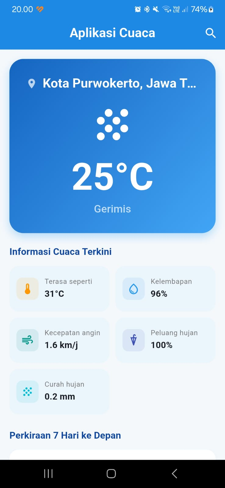
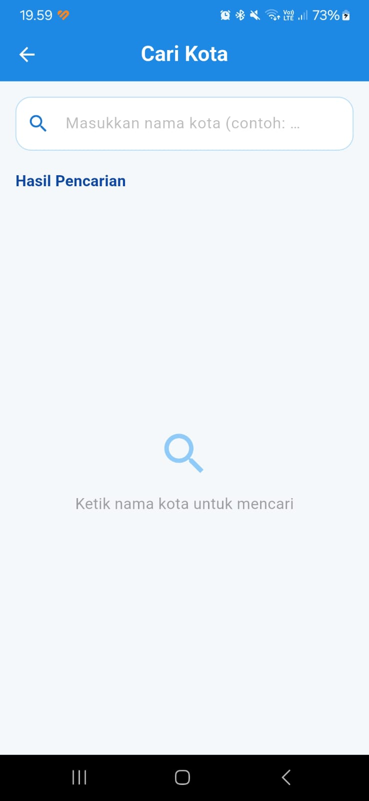
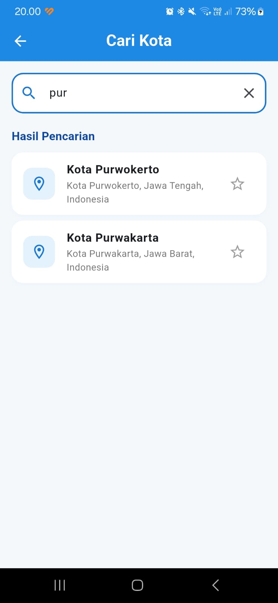
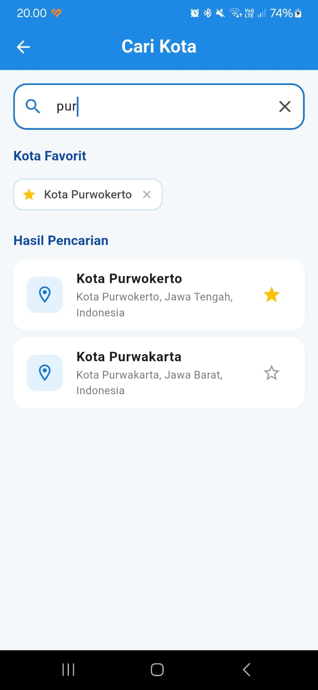
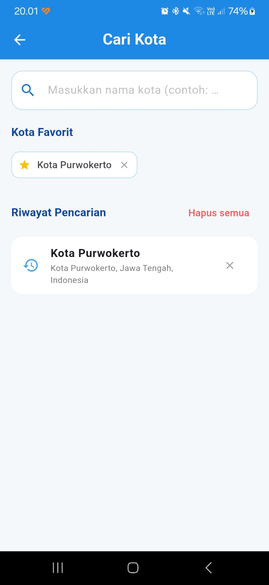
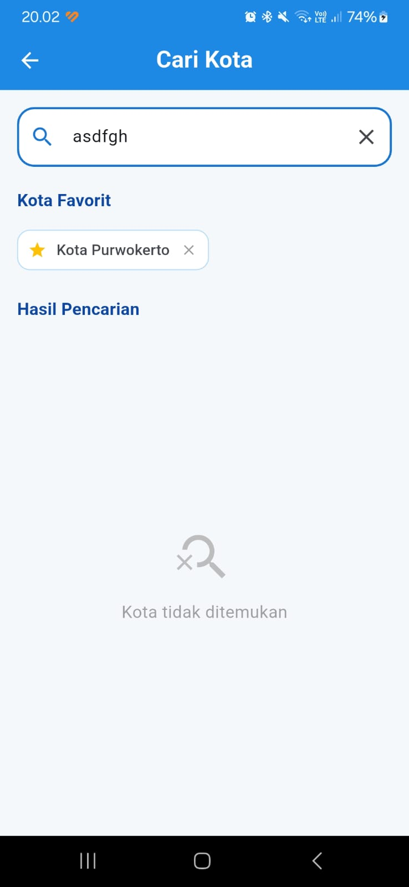
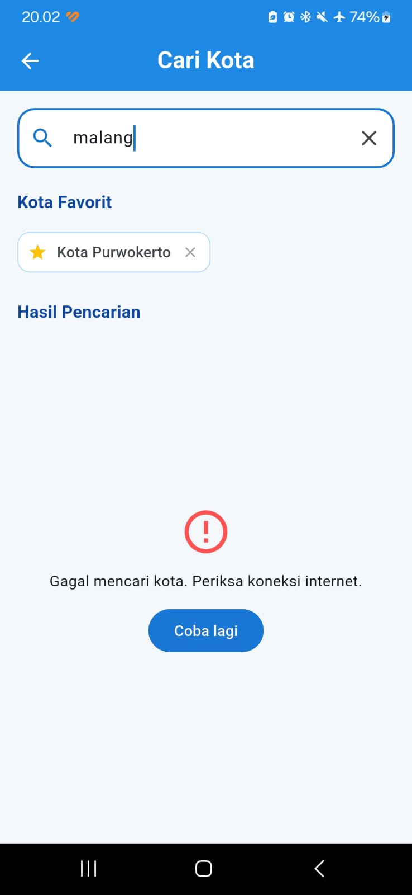

# Aplikasi Cuaca Flutter (Responsi Flutter)

Aplikasi cuaca seluler dan web berbasis Flutter yang dikembangkan untuk memenuhi tugas Responsi Pemrograman Mobile. Aplikasi ini menerapkan pola arsitektur **MVVM (Model-View-ViewModel)**, state management **Provider**, pengambilan data dinamis dari **Open-Meteo REST API**, serta penyimpanan lokal menggunakan **SharedPreferences**.

---

## 👤 Identitas Mahasiswa
* **Nama:** Nindya Alif Romland
* **NIM:** H1D024031
* **Shift Awal:** D
* **Shift Baru:** E

---

## 🚀 Fitur Utama
1. **Pencarian Kota dengan Live Search & Debounce:** Mencari nama kota di Indonesia secara real-time dengan jeda *debounce* 500 ms untuk efisiensi permintaan API.
2. **Cuaca Terkini:** Menampilkan suhu saat ini, suhu yang dirasakan, kelembapan udara, kecepatan angin, curah hujan, dan kode kondisi cuaca.
3. **Perkiraan Cuaca Harian:** Menampilkan prakiraan cuaca beberapa hari ke depan (suhu maksimum, suhu minimum, dan peluang hujan maksimum).
4. **Pull-to-Refresh:** Memperbarui data cuaca terkini dengan gestur usap ke bawah (*pull-to-refresh*) pada halaman utama.
5. **Lokasi Favorit:** Menyimpan dan mengelola daftar kota favorit dengan penyimpanan lokal (*Local Storage*).
6. **Riwayat Pencarian:** Mencatat riwayat pencarian kota yang pernah dikunjungi, lengkap dengan opsi hapus per item maupun "Hapus semua".
7. **Penanganan Kondisi UI:** Menangani status *loading* (indikator berputar), data kosong (*Kota tidak ditemukan*), dan error jaringan (lengkap dengan tombol "Coba lagi").

---

## 📱 Struktur Aplikasi & Arsitektur MVVM

Aplikasi ini disusun dengan pemisahan folder dan tanggung jawab yang bersih:

```text
lib/
├── main.dart                      # Titik masuk aplikasi, inisialisasi MultiProvider & MaterialApp
├── models/
│   ├── location_model.dart        # Model data lokasi kota & koordinat
│   └── weather_model.dart         # Model data cuaca terkini, harian, & helper deskripsi WMO
├── services/
│   ├── storage_service.dart       # Layanan local storage SharedPreferences (favorit, riwayat, lokasi terakhir)
│   └── weather_service.dart       # Layanan HTTP REST API (Geocoding & Forecast Open-Meteo)
├── viewmodels/
│   ├── search_viewmodel.dart      # Mengelola state pencarian, favorit, & riwayat pencarian
│   ├── weather_viewmodel.dart     # Mengelola state data cuaca kota terpilih & lokasi terakhir
│   └── view_state.dart            # Enum status UI (idle, loading, success, empty, error)
└── views/
    ├── home_screen.dart           # Screen utama menampilkan detail cuaca terkini & prakiraan harian
    ├── search_screen.dart         # Screen pencarian kota, riwayat, & daftar favorit
    └── weather_icons.dart         # Helper konversi kode cuaca WMO ke ikon Material
```

---

## 🌐 Implementasi API (Open-Meteo)

Aplikasi menggunakan **Open-Meteo REST API** secara dinamis tanpa memerlukan API Key, menggunakan metode **HTTP GET** (`http` package):
1. **Geocoding API** (`https://geocoding-api.open-meteo.com/v1/search`): Digunakan untuk mencari koordinat lintang (*latitude*) dan bujur (*longitude*) berdasarkan nama kota yang dimasukkan pengguna.
2. **Weather Forecast API** (`https://api.open-meteo.com/v1/forecast`): Mengambil data cuaca terkini (`current`) dan prakiraan harian (`daily`).

### Parameter Penting API:
* `latitude`: Koordinat lintang lokasi
* `longitude`: Koordinat bujur lokasi
* `current`: Data cuaca terkini
* `daily`: Data perkiraan cuaca harian
* `timezone`: Zona waktu lokasi (diatur `auto`)

### Tabel Data dan Field API yang Ditampilkan:
| Data | Field API |
| :--- | :--- |
| Suhu saat ini | `current.temperature_2m` |
| Kelembapan | `current.relative_humidity_2m` |
| Suhu yang dirasakan | `current.apparent_temperature` |
| Curah hujan | `current.precipitation` |
| Kode kondisi cuaca | `current.weather_code` |
| Kecepatan angin | `current.wind_speed_10m` |
| Suhu maksimum harian | `daily.temperature_2m_max` |
| Suhu minimum harian | `daily.temperature_2m_min` |
| Peluang hujan maksimum | `daily.precipitation_probability_max` |

*Catatan:* Seluruh respons data dari server diterima dalam format JSON dan diubah menjadi model data Dart menggunakan *factory constructor* `.fromJson()`. Semua data cuaca yang tampil di aplikasi murni berasal dari API, bukan data statis atau *hardcoded*.

---

## ⚙️ Penerapan MVVM & State Management

### Pola Arsitektur MVVM
* **Model (`lib/models/`):** Merepresentasikan struktur data yang diterima dari API dan yang disimpan di *Local Storage*.
* **View (`lib/views/`):** Antarmuka pengguna murni (`HomeScreen`, `SearchScreen`) yang bertugas merender tampilan dan mendengarkan perubahan dari ViewModel. View tidak pernah memanggil API atau Storage secara langsung.
* **ViewModel (`lib/viewmodels/`):** Mengelola logika bisnis, memproses data dari Service, dan memperbarui *state* reaktif (`WeatherViewModel`, `SearchViewModel`).
* **Service (`lib/services/`):** Menangani komunikasi luar seperti HTTP request (`WeatherService`) dan pembacaan/penulisan `SharedPreferences` (`StorageService`).

### Alur Kerja (Flow):
`View` memanggil fungsi di `ViewModel` $\rightarrow$ `ViewModel` meminta data ke `Service` $\rightarrow$ `Service` melakukan request ke API / Storage $\rightarrow$ `ViewModel` menerima data, mengubah *state*, lalu memanggil `notifyListeners()` $\rightarrow$ `View` membaca pembaruan *state* lewat *Provider* dan memperbarui tampilan secara otomatis.

### Contoh Konkret:
Di `SearchViewModel`, ketika method `search(query)` dipanggil, ViewModel mengubah `state = ViewState.loading` lalu memanggil `notifyListeners()`. `SearchScreen` yang mendengarkan perubahan ini (`context.watch<SearchViewModel>()`) langsung menampilkan indikator *loading* (`CircularProgressIndicator`). Setelah data diterima dari API, ViewModel mengubah `state = ViewState.success` dan memperbarui `results`, sehingga *View* langsung merender daftar kota yang ditemukan.

### State Management & Enum ViewState
Menggunakan package **Provider** (`ChangeNotifierProvider`, `MultiProvider`, `Consumer`) dengan *enum* `ViewState`:
* `ViewState.idle`: Kondisi awal / belum ada pencarian.
* `ViewState.loading`: Proses permintaan data sedang berlangsung.
* `ViewState.success`: Data berhasil diterima dan siap ditampilkan.
* `ViewState.empty`: Permintaan berhasil namun data tidak ditemukan.
* `ViewState.error`: Terjadi kegagalan koneksi atau server.

---

## 💾 Local Storage (SharedPreferences)

Aplikasi mengimplementasikan penyimpanan lokal menggunakan package **`shared_preferences`** untuk menyimpan:
1. **Lokasi Favorit (`favorites`):** Daftar kota yang ditandai sebagai favorit oleh pengguna.
2. **Riwayat Pencarian (`history`):** Daftar kota yang pernah dicari/dikunjungi (maksimal 10 item terbaru).
3. **Lokasi Terakhir (`last_location`):** Kota terakhir yang dibuka pengguna agar otomatis dimuat kembali saat aplikasi dibuka kembali.

Data disimpan dalam format JSON (`jsonEncode` / `jsonDecode`) dan akan dimuat secara otomatis saat aplikasi dijalankan melalui method `init()`, `loadFavorites()`, dan `loadHistory()`.

---

## 🎨 UI dan Theme

* **Material Design 3:** Menggunakan standar Material Design (`useMaterial3: true`).
* **Theme Konsisten:** Mengonfigurasi `ThemeData` dengan `ColorScheme` bernuansa biru (`Colors.blue.shade700`), `CardTheme`, dan `AppBarTheme` yang seragam.
* **Responsif:** Tata letak menggunakan `ListView`, `GridView`, dan `RefreshIndicator` agar nyaman digunakan di berbagai ukuran layar.
* **Penggunaan Widget:** Menggunakan kombinasi `StatelessWidget` untuk komponen statis dan `StatefulWidget` (pada `SearchScreen`) untuk mengelola *controller* teks serta *debounce timer*.

---

## 📸 Screenshot Aplikasi

### Screen Utama
| Home / Weather Screen | Search Screen |
| :---: | :---: |
|  |  |
| Tampilan utama cuaca terkini & prakiraan harian | Halaman pencarian kota |

### Pencarian dan Favorit
| Hasil Pencarian | Lokasi Favorit | Riwayat Pencarian |
| :---: | :---: | :---: |
|  |  |  |
| Daftar hasil pencarian kota di Indonesia | Daftar kota favorit tersimpan | Riwayat pencarian kota |

### Kondisi Aplikasi
| Data Kosong | Error |
| :---: | :---: |
|  |  |
| Kondisi "Kota tidak ditemukan" | Kondisi error & tombol "Coba lagi" |

---

## 📹 Video Penjelasan
Link video: https://youtu.be/XwQF7vcbnMw?si=BStSaPOfMGa2lMtu

---

## 🛠️ Cara Menjalankan Proyek

### Prasyarat:
* Pastikan **Flutter SDK** (versi 3.13 atau terbaru) sudah terinstal di komputer Anda.

### Langkah-langkah:
1. Unduh atau *clone* repositori proyek ini.
2. Buka terminal pada direktori root proyek.
3. Unduh *dependencies* yang diperlukan dengan perintah:
   ```bash
   flutter pub get
   ```
4. Jalankan aplikasi di emulator atau perangkat terhubung:
   ```bash
   flutter run
   ```
   *Catatan:* Aplikasi ini juga dapat dijalankan di browser web (Chrome) dengan perintah:
   ```bash
   flutter run -d chrome
   ```
